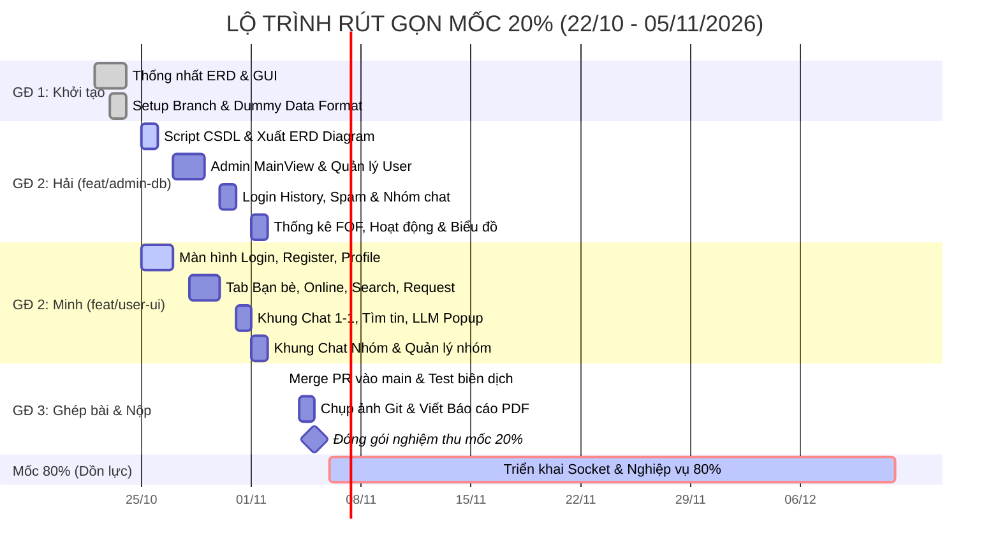

# MA TRẬN PHÂN CÔNG CÔNG VIỆC & KẾ HOẠCH RÚT GỌN (MỐC 20%)

> **Dự án:** Java Chat System (Đồ án Lập trình ứng dụng Java)  
> **Cập nhật 29/10/2026:** Hải và Minh đồng ý chuyển Swing + FlatLaf sang JavaFX 21 + CSS; dùng JavaFX Charts cho biểu đồ. Cấu trúc code theo Maven tại `src/main/java/com/chatapp/`; các tên `Panel`/`Frame` còn lại trong kế hoạch chỉ là tên dự kiến, không yêu cầu kế thừa Swing.
> **Căn cứ pháp lý:** [Final Project.pdf](file:///d:/JavaChatProject/docs/Final%20Project.pdf) (Khoa CNTT - BM Công nghệ phần mềm)  
> **Phân vai chính thức:**
> - **Thành viên A (Hải):** Phụ trách Admin UI (9 nhóm chức năng) + Script CSDL PostgreSQL + Phần Thiết kế CSDL & Màn hình Admin trong báo cáo.
> - **Thành viên B (Minh):** Phụ trách User UI (12 nhóm chức năng) + Khởi tạo Repo Git/Maven + Dựng khung Báo cáo & Phần Màn hình User trong báo cáo.
>
> **Mốc thời gian điều chỉnh (Chiến lược về đích sớm):**
> - *Hạn chót chính thức mốc 20% của môn học:* **22/11/2026**
> - *Mục tiêu nội bộ nhóm hoàn thành mốc 20%:* **05/11/2026** *(Rút ngắn 17 ngày để dồn toàn lực cho mốc 80% — Hạn chót toàn đồ án: 12/12/2026)*.

---

## 1. Đối chiếu & Chuẩn hóa Kế hoạch theo Đề bài Gốc (Final Project.pdf)

Sau khi rà soát chéo giữa bản nháp kế hoạch và [Final Project.pdf](file:///d:/JavaChatProject/docs/Final%20Project.pdf), các điểm cần lưu ý và bổ sung gồm:

1. **Cấu trúc nén nộp bài mốc 20% (Tuyệt đối không được sai để tránh bị 0đ):**
   ```text
   NopBai_NhomXX_20pct.zip
   ├── src/
   │   ├── admin/      (Mã nguồn màn hình Admin của Hải)
   │   └── user/       (Mã nguồn màn hình User của Minh)
   ├── script/         (File database.sql của Hải)
   ├── git/            (Ảnh chụp màn hình commit của Hải và Minh)
   └── BaoCao.pdf      (Báo cáo nhóm đầy đủ 5 phần bắt buộc)
   ```
2. **Các chi tiết màn hình Admin của Hải cần đảm bảo khớp đề:**
   - *Quản lý User:* Form xem/thêm/sửa phải có đủ các trường: `username`, `fullname`, `address`, `dob` (ngày sinh), `gender`, `email`, `status`.
   - *Thống kê Bạn bè (Yêu cầu 7):* Phải có bộ lọc số lượng bạn bè trực tiếp gồm ComboBox toán tử (`=`, `<`, `>`) và ô nhập số.
   - *Người dùng hoạt động (Yêu cầu 8):* Phải hiển thị đủ 3 cột số liệu (Mở app, Chat bao nhiêu người, Chat bao nhiêu nhóm) và có bộ lọc số lượng hoạt động (`=`, `<`, `>`).
3. **Các chi tiết màn hình User của Minh cần đảm bảo khớp đề:**
   - *Tab Bạn bè Online (Yêu cầu 8):* Tách rõ danh sách bạn đang online có chấm xanh, có nút Chat nhanh và nút Tạo nhóm.
   - *Tìm kiếm người dùng (Yêu cầu 9):* Kết quả tìm kiếm (loại trừ người đã chặn mình) phải có nút Chat và Tạo nhóm trực tiếp.
   - *Tìm kiếm tin nhắn (Yêu cầu 11f, 11g):* Phân biệt rõ tìm trong 1 cuộc hội thoại và tìm toàn bộ các cuộc hội thoại; có nút điều hướng (Lên/Xuống) để nhảy đến đúng đoạn chat.
   - *Nhóm chat (Yêu cầu 12):* Tạo nhóm phải cho phép thêm tối thiểu 1 người; có cờ Mã hóa nhóm; danh sách thành viên phải phân biệt Admin nhóm và chỉ Admin nhóm mới có nút Xóa thành viên.

---

## 2. Lịch trình Thực hiện Rút gọn (Target Finish: 05/11/2026)



---

## 3. Chi tiết Phân công Công việc Từng Thành viên

### 3.1 Thành viên A — Hải (Nhánh `feat/admin-db`)
*Mục tiêu: Hoàn tất 11 màn hình JavaFX + CSS với dữ liệu mẫu đẹp mắt, script CSDL sạch và tối thiểu 8–10 commits.*

| STT | Tên Commit dự kiến | Màn hình / Thành phần UI | Mô tả chi tiết & Dummy Data cần có | Hạn chót |
| :---: | :--- | :--- | :--- | :---: |
| **H1** | `feat(db): finalize script/database.sql and ERD diagram` | `script/database.sql` | 13 bảng PostgreSQL đã test 100% PASS, xuất ảnh ERD diagram độ phân giải cao đưa vào thư mục docs/báo cáo. | 26/10 |
| **H2** | `feat(admin-ui): create AdminMainView and navigation sidebar` | `AdminApplication`, `AdminMainView` | Cửa sổ JavaFX 1000x700, CSS sáng/tối, thanh Sidebar trái với menu 9 chức năng và Header thông tin Admin. | 27/10 |
| **H3** | `feat(admin-ui): implement UserManagementPanel and UserDetailDialog` | `UserManagementPanel`, `UserDetailDialog` | Bảng danh sách User (10 dòng mẫu), lọc tên/username/status, sắp xếp; các nút Thêm/Sửa/Xóa/Khóa/ResetPass; Dialog xem login history & friend list. | 29/10 |
| **H4** | `feat(admin-ui): implement GlobalLoginHistoryPanel` | `GlobalLoginHistoryPanel` | Bảng hiển thị lịch sử đăng nhập chung (thời gian, username, họ tên), lọc theo thời gian. | 30/10 |
| **H5** | `feat(admin-ui): implement GroupManagementPanel and GroupDetailDialog` | `GroupManagementPanel` | Bảng danh sách nhóm chat (sắp xếp tên/ngày tạo, lọc tên), Dialog xem danh sách thành viên và danh sách Admin nhóm. | 31/10 |
| **H6** | `feat(admin-ui): implement SpamReportPanel with action dialogs` | `SpamReportPanel` | Bảng báo cáo spam (thời gian, người gửi báo cáo, người bị báo cáo, lý do), sắp xếp/lọc thời gian/username, nút Khóa tài khoản vi phạm. | 31/10 |
| **H7** | `feat(admin-ui): implement NewUsersPanel and FriendStatisticsPanel` | `NewUsersPanel`, `FriendStatisticsPanel` | - Màn hình đăng ký mới: Date Picker khoảng thời gian.<br>- Màn hình FOF: Cột bạn trực tiếp, bạn của bạn; ComboBox toán tử (`=`, `<`, `>`) và ô nhập số lượng bạn. | 01/11 |
| **H8** | `feat(admin-ui): implement ActiveUsersPanel with filter criteria` | `ActiveUsersPanel` | Bảng thống kê hoạt động (Mở app, Chat bao nhiêu người, Chat bao nhiêu nhóm), bộ lọc khoảng thời gian và lọc số lượng hoạt động (`=`, `<`, `>`). | 02/11 |
| **H9** | `feat(admin-ui): implement RegistrationChartPanel and ActivityChartPanel` | `RegistrationChartPanel`, `ActivityChartPanel` | 2 biểu đồ cột mẫu JavaFX `BarChart` có ComboBox chọn năm, trục hoành 12 tháng, trục tung số lượng. | 02/11 |

---

### 3.2 Thành viên B — Minh (Nhánh `feat/user-ui`)
*Mục tiêu: Hoàn tất 13 màn hình/dialog User JavaFX + CSS với dummy chat data sống động, khung báo cáo và tối thiểu 8–10 commits.*

| STT | Tên Commit dự kiến | Màn hình / Thành phần UI | Mô tả chi tiết & Dummy Data cần có | Hạn chót |
| :---: | :--- | :--- | :--- | :---: |
| **M1** | `feat(user-ui): create LoginFrame and RegisterFrame` | `UserLoginFrame`, `UserRegisterFrame` | Màn hình đăng nhập hiện đại, form đăng ký đầy đủ (username, họ tên, địa chỉ, ngày sinh, giới tính, email). | 26/10 |
| **M2** | `feat(user-ui): implement ForgotPasswordDialog and ProfileDialog` | `ForgotPasswordDialog`, `UserProfileDialog` | Dialog quên mật khẩu (nhập email nhận pass ngẫu nhiên); Dialog cập nhật profile cá nhân và đổi mật khẩu. | 27/10 |
| **M3** | `feat(user-ui): create UserMainChatFrame layout and tabs` | `UserMainChatFrame` | Khung chat tổng thể 1000x700: Cột trái (Tabs Bạn bè/Nhóm), Cột giữa (Vùng hội thoại), Cột phải (Thông tin/Thành viên). | 28/10 |
| **M4** | `feat(user-ui): implement FriendListPanel and OnlineFriendsPanel` | `FriendListPanel`, `OnlineFriendsPanel` | - Danh sách bạn bè: chấm xanh/xám, lọc tên, nút Hủy bạn, nút Block.<br>- Tab Bạn Online: lọc tên, nút Chat ngay, nút Tạo nhóm. | 29/10 |
| **M5** | `feat(user-ui): implement FriendRequestDialog and UserSearchDialog` | `FriendRequestDialog`, `UserSearchDialog` | - Danh sách yêu cầu kết bạn: nút Đồng ý/Từ chối.<br>- Tìm kiếm người dùng: tìm theo username/họ tên, kết quả có nút Kết bạn, Chat, Tạo group. | 30/10 |
| **M6** | `feat(user-ui): implement ChatPanel1on1 with message history` | `ChatPanel1on1` | Khung chat 1-1 với các bong bóng tin nhắn mẫu (trái/phải), thanh tiêu đề có nút Báo cáo spam, nút Xóa toàn bộ lịch sử, thanh tìm kiếm. | 31/10 |
| **M7** | `feat(user-ui): implement ChatSearchDialog and MessageContextMenu` | `ChatSearchDialog`, `MessagePopupMenu` | Popup/Menu chuột phải xóa 1 hoặc vài dòng tin nhắn; Dialog tìm kiếm chuỗi tin nhắn với 1 người hoặc tất cả kèm nút di chuyển Lên/Xuống. | 01/11 |
| **M8** | `feat(user-ui): implement LLMAssistPopup for chat suggestions` | `LLMAssistPopup` | Nút icon cạnh ô nhập chat, bấm mở popup hiển thị các câu gợi ý trả lời lịch sự/chỉnh sửa câu văn từ AI. | 01/11 |
| **M9** | `feat(user-ui): implement GroupChatPanel and GroupCreationDialog` | `GroupChatPanel`, `GroupCreateDialog` | Dialog tạo nhóm (thêm >= 1 username, cờ mã hóa); Panel chat nhóm kèm sidebar quản lý thành viên (đổi tên, thêm người, gán admin, xóa member). | 02/11 |
| **M10**| `docs(report): setup report template and table of contents` | `docs/BaoCao_Draft.docx` (hoặc LaTeX) | Khởi tạo khung tài liệu báo cáo gồm đủ 5 mục chính theo yêu cầu đề bài. | 03/11 |

---

## 4. Giai đoạn Tích hợp & Đóng gói Nghiệm thu (03/11 - 05/11/2026)

1. **Merge code & Kiểm thử biên dịch (03/11/2026):**
   - Tạo Pull Request từ `feat/admin-db` và `feat/user-ui` vào `main`.
   - Hải làm trong `src/main/java/com/chatapp/admin`, Minh làm trong `src/main/java/com/chatapp/user`; tài nguyên UI đặt theo package trong `src/main/resources`. `pom.xml` và phần dùng chung cần review A–B, không mặc định merge sẽ không có xung đột.
   - Chạy lệnh biên dịch thử: bảo đảm không có lỗi `compile error`.
2. **Minh chứng Git (04/11/2026):**
   - Vào GitHub repository, lọc commit của Hải -> Chụp màn hình lưu vào `git/commits_Hai.png`.
   - Lọc commit của Minh -> Chụp màn hình lưu vào `git/commits_Minh.png`.
3. **Hoàn thiện Báo cáo PDF (04/11 - 05/11/2026):**
   - **Mục 1:** Thông tin nhóm (Họ tên, MSSV của Hải và Minh).
   - **Mục 2:** Danh sách công việc từng thành viên (bám sát bảng phân vai trên).
   - **Mục 3:** Bảng đóng góp: Hải (50%), Minh (50%) — Tổng = 100%.
   - **Mục 4:** Thiết kế cơ sở dữ liệu: Hải chèn sơ đồ ERD 13 bảng và tóm tắt ý nghĩa ràng buộc.
   - **Mục 5:** Danh sách màn hình đã thiết kế: Dán hình chụp 11 màn hình Admin (Hải) và 13 màn hình User (Minh) kèm chú thích ngắn gọn.
4. **Kiểm tra đóng gói file nén (05/11/2026):**
   - Tạo file `.zip` theo cấu trúc bắt buộc: gồm đúng 3 thư mục `src/`, `script/`, `git/` và tệp `BaoCao.pdf`.

---

## 5. Kế hoạch Tiếp nối cho Mốc 80% (06/11 - 12/12/2026)

Sau khi cán đích mốc 20% vào ngày 05/11/2026, nhóm sẽ có **trọn vẹn 37 ngày** để triển khai các hạng mục kỹ thuật cốt lõi:
- **Tuần 1 (06/11 - 13/11):** Xây dựng Java TCP Socket Server, ClientHandler, ThreadPool, Gson Envelope protocol.
- **Tuần 2 (14/11 - 21/11):** Tích hợp Database pgJDBC, Connection Pool, Login/Register BCrypt, Phân quyền Admin/User.
- **Tuần 3 (22/11 - 29/11):** Chat 1-1 realtime/offline, Watermark xóa tin, Quản lý bạn bè, Block, Báo cáo Spam.
- **Tuần 4 (30/11 - 06/12):** Chat nhóm mã hóa Server-side AES-GCM, Jakarta Mail reset pass, Java 21 HttpClient gọi LLM API.
- **Tuần 5 (07/12 - 12/12):** JavaFX Charts thống kê Admin, Đóng gói 2 file JAR (`Admin.jar`, `User.jar`) kèm file cấu hình DB, Quay video demo Youtube và hoàn tất báo cáo cuối kỳ.

