# Báo cáo phần Admin và cơ sở dữ liệu — Mốc 20%

**Người thực hiện:** Lưu Chí Hải — MSSV 24127030.  
**Ngày đối chiếu:** 16/11/2026.  
**Phạm vi:** Phần thiết kế CSDL và màn hình Admin để ghép vào báo cáo chung của nhóm.

## 1. Phạm vi thực hiện

Phân hệ Admin được xây dựng bằng Java 21, JavaFX 21.0.5 và CSS, gồm thanh điều hướng với 9 nhóm chức năng theo đề. Giao diện hỗ trợ theme sáng/tối, bảng dữ liệu, bộ lọc, biểu đồ và các hộp thoại quản lý người dùng. Cửa sổ được kiểm tra ở kích thước chuẩn khoảng 1000×700 và khi phóng to.

Ở mốc 20%, các màn hình sử dụng dữ liệu mẫu dùng chung trong bộ nhớ. Thêm/cập nhật hồ sơ, khóa/mở khóa và xóa mềm được mô phỏng; thay đổi phản ánh trên các trang liên quan và mất khi khởi động lại. Chưa có đăng nhập Admin, kết nối JDBC/Server, gửi email hoặc thay mật khẩu thật. Cơ sở dữ liệu PostgreSQL được kiểm chứng độc lập với bản mẫu giao diện.

Yêu cầu gốc được đối chiếu từ [đề bài, trang 2 và 4](../final-project.pdf). Báo cáo này chỉ trình bày phần Hải phụ trách; phần User, tỷ lệ đóng góp và thông tin tổng hợp do nhóm rà soát trước khi nộp.

## 2. Thiết kế cơ sở dữ liệu

### 2.1. Tổ chức dữ liệu

CSDL dùng PostgreSQL, có **13 bảng, 65 cột và 21 khóa ngoại**. Thiết kế tách hồ sơ người dùng, quan hệ xã hội, lịch sử cá nhân và dữ liệu nhóm để giữ được thông tin lịch sử khi trạng thái tài khoản thay đổi.

| Nhóm | Bảng | Mục đích |
|---|---|---|
| Người dùng và hoạt động | `users`, `login_history`, `activity_logs` | Hồ sơ, vai trò hệ thống, lịch sử đăng nhập và sự kiện mở ứng dụng theo phiên. |
| Bạn bè và chặn | `friend_requests`, `friendships`, `user_blocks` | Lời mời, cặp bạn bè hiện tại và quan hệ chặn có hướng. |
| Tin nhắn cá nhân | `direct_messages`, `message_hidden`, `conversation_clears` | Nội dung chat, ẩn từng tin và mốc xóa lịch sử một phía. |
| Nhóm chat | `chat_groups`, `group_members`, `group_messages` | Thông tin nhóm, thành viên/quyền Admin nhóm và tin nhắn nhóm. |
| Báo cáo spam | `spam_reports` | Người báo cáo, người bị báo cáo, lý do và thời điểm. |

Nguồn đặc tả duy nhất là [schema hiện hành](../database/schema.md); tệp tạo CSDL là [database.sql](../../script/database.sql). Phần dưới là bản trích ERD phục vụ báo cáo, không thay thế schema. Nếu CSDL thay đổi, cần xuất lại từ nguồn trước khi dùng ảnh/sơ đồ này.

### 2.2. Sơ đồ quan hệ thực thể

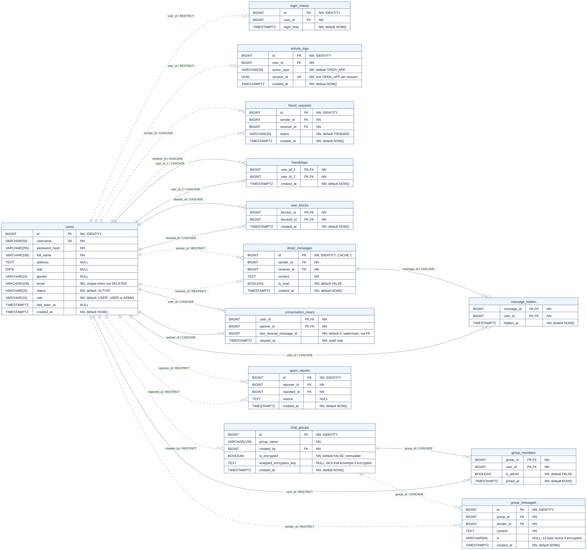

*Sơ đồ CSDL: trích nguyên khối Mermaid ERD từ schema ngày 16/11/2026. PK: khóa chính; FK: khóa ngoại; NN: không được NULL. Nhãn RESTRICT/CASCADE biểu thị chính sách xóa vật lý ở FK, không phải thao tác xóa mềm của ứng dụng.*

### 2.3. Các quyết định chính

- ID dùng `BIGINT GENERATED ALWAYS AS IDENTITY`; thời gian dùng `TIMESTAMPTZ`. Khoảng ngày trên giao diện được tính theo giờ Việt Nam và bao gồm cả hai ngày biên.
- Xóa mềm đổi `users.status` thành `DELETED`, giữ ID và lịch sử. Username vẫn duy nhất trên toàn bảng; email chỉ duy nhất giữa các hồ sơ chưa xóa nhờ chỉ mục `uq_users_email_not_deleted`. Tài khoản mới dùng lại email luôn có ID mới, không nhận lịch sử của hồ sơ cũ.
- Vai trò hệ thống `users.role` độc lập với `group_members.is_admin`. Bảo vệ Admin hoạt động cuối cùng và thu hồi phiên là trách nhiệm của Server; bản mẫu Admin đã mô phỏng bảo vệ thao tác này.
- Sự kiện mở app có `session_id` duy nhất để hỗ trợ chống ghi trùng phiên. Thống kê hoạt động theo tháng đếm người khác nhau, không đếm số lần mở app.
- CSDL có **31 CHECK, 17 chỉ mục tường minh và 2 trigger ứng dụng**. Tổng số index là 33 khi tính cả index do PK/UNIQUE tạo ra. Hai trigger bảo vệ chế độ mã hóa nhóm và tính nhất quán của IV/sender; chúng không chứng minh dữ liệu đã được mã hóa.
- Thiết kế mã hóa dự kiến dùng AES-GCM phía Server và khóa được bọc; chưa triển khai mã hóa thực tế ở mốc này, không tuyên bố là E2EE. Khả năng đáp ứng yêu cầu mã hóa cần tiếp tục xác nhận với giảng viên.

### 2.4. Kết quả kiểm chứng SQL

Ngày 16/11/2026, nhóm kiểm chứng DDL hiện hành trên **PostgreSQL 16.12** trong database mới dùng riêng. DDL tạo thành công schema từ public có 0 bảng; chạy lại trên schema đã có bị từ chối đúng. Bộ test email/schema đạt **25 PASS**, bộ kiểm tra bổ sung đạt **8 PASS** về rollback, trigger và bảo vệ lịch sử bằng FK. Sau rollback, dữ liệu thử không còn; container/database tạm đã được dọn.

Đây là kiểm thử ràng buộc SQL. Chưa kiểm thử quyền role runtime, truy cập đồng thời, JDBC, SMTP hoặc nghiệp vụ qua TCP Server. Chi tiết lệnh, hash DDL và giới hạn nằm tại [schema mục 4.8](../database/schema.md#48-kiểm-thử-ràng-buộc-email) và [checklist T19](implementation-tasks.md).

## 3. Danh sách màn hình Admin

Các mục 3.1–3.9 tương ứng 9 nhóm chức năng trong đề. A1 là khung chung; A3 là các dialog của quản lý người dùng. Ảnh chụp trực tiếp từ bản chạy ngày 16/11/2026, không phải bản dựng thiết kế hoặc bằng chứng dữ liệu Server thật. Thanh cuộn cho phép xem các dòng chưa hiện trong khung ảnh.

### 3.1. Quản lý người dùng — A1/A2/A3

Bảng hiển thị hồ sơ, trạng thái và ngày tạo; có lọc họ tên/username/trạng thái và sắp xếp tên/ngày tạo. Các nút mở form thêm/cập nhật, xem hồ sơ, lịch sử, bạn bè, mật khẩu mẫu hoặc thao tác trạng thái. Khi chưa chọn dòng, thao tác cần đối tượng được vô hiệu hóa; Admin hoạt động cuối cùng không thể bị khóa/xóa trong bản mẫu.

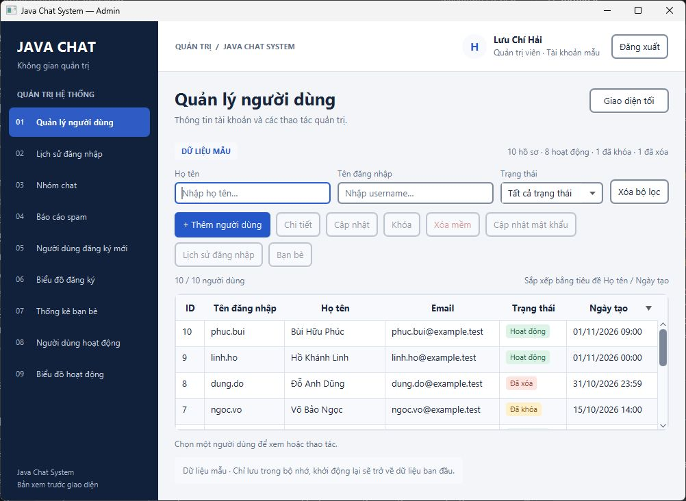

*Hình 1. Danh sách 10 hồ sơ mẫu, có tài khoản hoạt động, đã khóa và đã xóa. Các dialog chi tiết được trình bày ở mục 4.*

### 3.2. Lịch sử đăng nhập chung — A4

Màn hình hiển thị thời điểm đăng nhập, username và họ tên, mặc định mới nhất trước. Có lọc username/khoảng ngày, xóa bộ lọc và thông báo khi ngày nhập không hợp lệ. Lịch sử vẫn được giữ khi tài khoản hiện đã khóa/xóa.

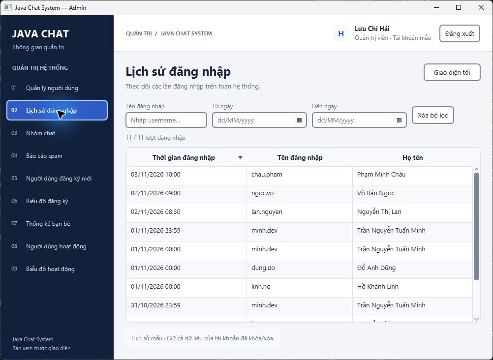

*Hình 2. Nguồn mẫu có 11 lượt đăng nhập, được dùng lại cho dialog lịch sử cá nhân.*

### 3.3. Nhóm chat — A5

Danh sách nhóm cho lọc tên và sắp xếp tên/ngày tạo. Chọn một nhóm để xem thành viên và Admin nhóm. Cột mã hóa chỉ minh họa cấu hình nhóm, chưa thực hiện mã hóa.

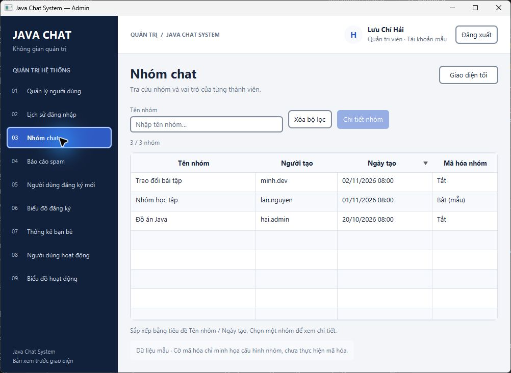

*Hình 3. Ba nhóm mẫu; chi tiết nhóm được minh họa ở Hình 16.*

### 3.4. Báo cáo spam — A6

Bảng có thời gian, người báo cáo, người bị báo cáo, lý do và trạng thái tài khoản. Có lọc theo người bị báo cáo/khoảng ngày và thao tác khóa tài khoản mẫu với hộp xác nhận. Hủy không đổi trạng thái hoặc xóa báo cáo.

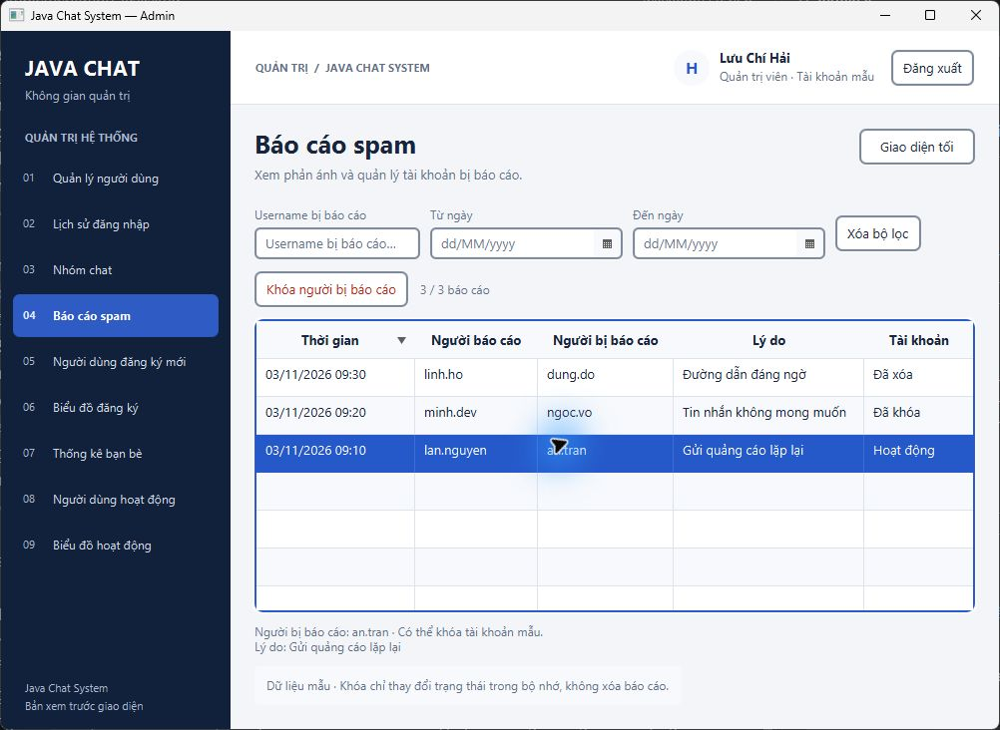

*Hình 4. Chọn báo cáo #1 cho `an.tran`; nút khóa được bật khi đối tượng còn đủ điều kiện.*

### 3.5. Người dùng đăng ký mới — A7

Lọc theo họ tên và ngày tạo, sắp xếp tên/ngày tạo. Tài khoản khóa/xóa vẫn thuộc lịch sử đăng ký; cột trạng thái giải thích trạng thái hiện tại của hồ sơ.

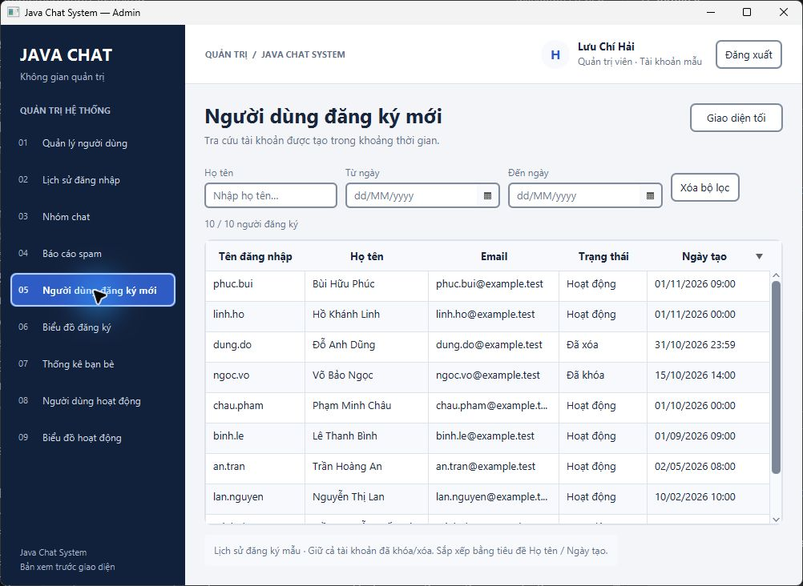

*Hình 5. Khi chưa giới hạn khoảng ngày, hiển thị toàn bộ 10 hồ sơ mẫu.*

### 3.6. Biểu đồ đăng ký — A10

Chọn hoặc nhập năm để xem đủ 12 tháng. Trục Y đếm tài khoản theo ngày tạo, gồm cả hồ sơ hiện đã khóa/xóa. Bên dưới có số liệu từng tháng; năm không có dữ liệu vẫn có đủ 12 giá trị 0.

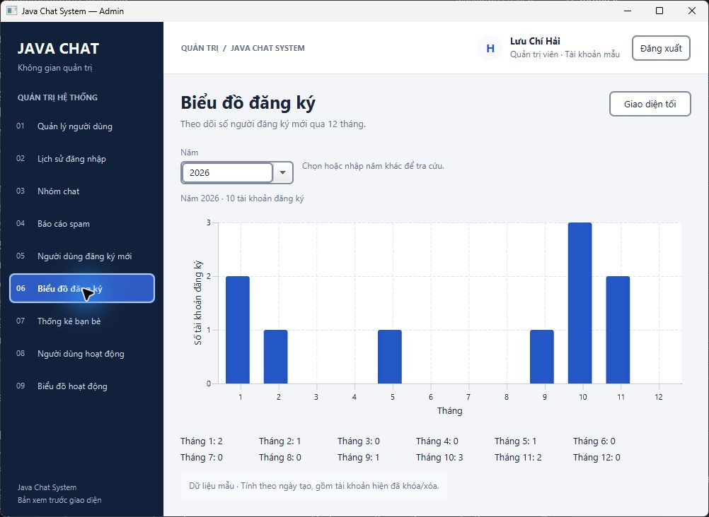

*Hình 6. Năm 2026 có tổng 10 tài khoản; tháng 10 có 3 tài khoản đăng ký.*

### 3.7. Thống kê bạn bè — A8

Hiển thị số bạn trực tiếp và số bạn bậc hai khác nhau; loại chính mình và bạn trực tiếp khỏi tập bậc hai. Có lọc họ tên, số bạn trực tiếp với =/< />, sắp xếp và kiểm tra số nguyên không âm. Hồ sơ DELETED bị loại ở chủ thể, nút trung gian và đích; hồ sơ LOCKED vẫn giữ quan hệ.

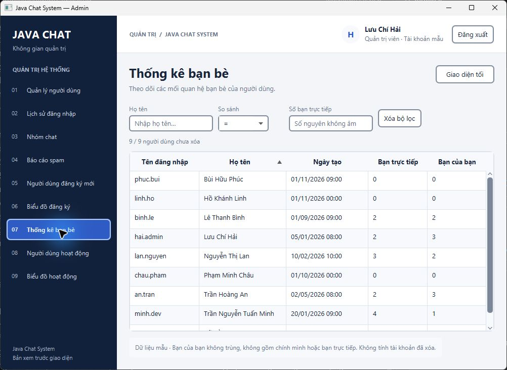

*Hình 7. Hải có 2 bạn trực tiếp và 3 bạn bậc hai trong đồ thị mẫu. Đây là cách nhóm diễn giải cột bạn của bạn; nếu giảng viên yêu cầu cộng cả bậc một thì cần thống nhất lại.*

### 3.8. Người dùng hoạt động — A9

Lọc họ tên/khoảng ngày và chọn một trong ba chỉ số: lượt mở app, số người đã chat hoặc số nhóm đã chat. Người/nhóm được đếm theo đối tượng khác nhau mà user chủ động gửi tin. Chỉ hiện user có hoạt động trong khoảng chọn, giữ lịch sử của hồ sơ hiện đã khóa/xóa.

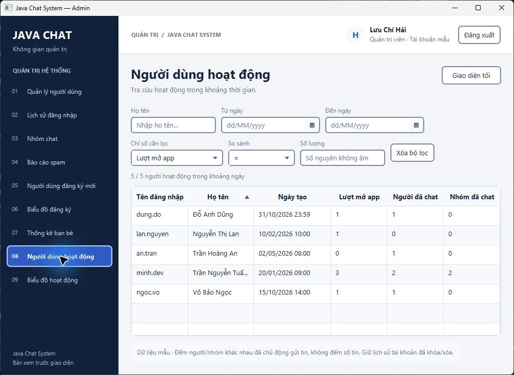

*Hình 8. Có 5 chủ thể hoạt động trong toàn bộ nguồn mẫu; `minh.dev` có 3 lượt mở app, đã chat với 2 người và 2 nhóm.*

### 3.9. Biểu đồ hoạt động — A11

Chọn hoặc nhập năm để xem số người khác nhau có sự kiện OPEN_APP trong từng tháng. Một người mở nhiều lần trong tháng chỉ được tính một lần; các tháng không có sự kiện hiện 0.

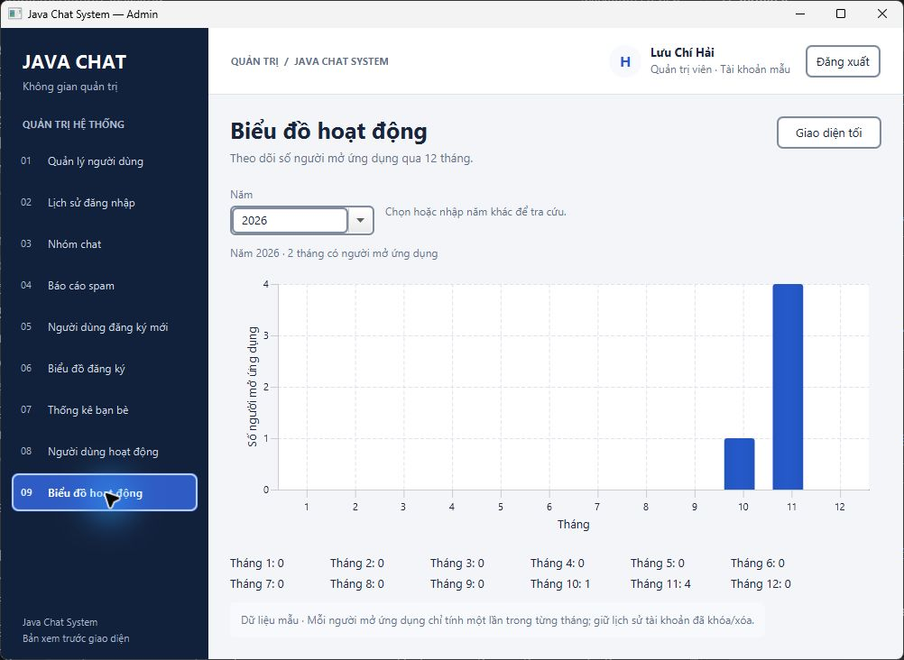

*Hình 9. Năm 2026: tháng 10 có 1 người mở app, tháng 11 có 4 người; đây không phải số phiên hoặc số người đang online.*

## 4. Các dialog và theme bổ sung

### 4.1. Thêm hồ sơ mẫu

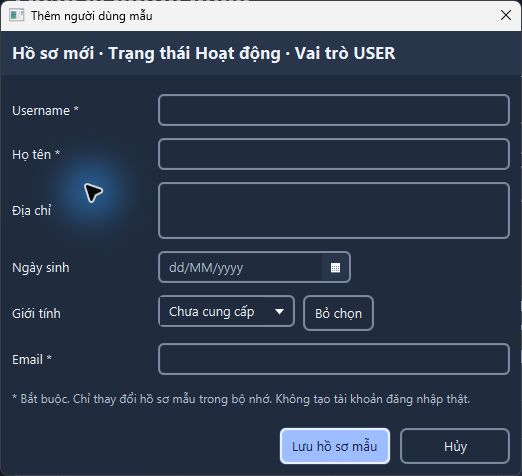

*Hình 10. Có username, họ tên, địa chỉ, ngày sinh, giới tính và email. Form thêm hồ sơ mẫu không tạo tài khoản đăng nhập thật.*

### 4.2. Cập nhật hồ sơ

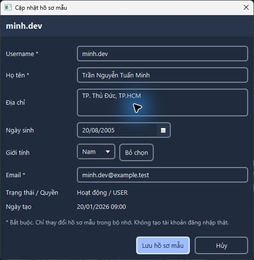

*Hình 11. Các trường được nạp từ đúng hồ sơ `minh.dev`; ảnh được chụp trước khi sửa và dialog đã được Hủy.*

### 4.3. Hồ sơ chỉ xem

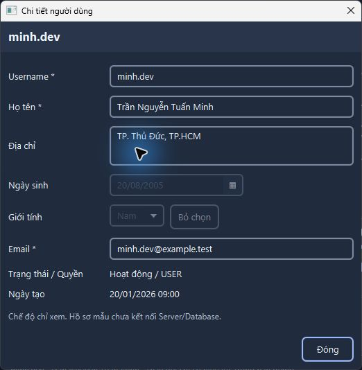

*Hình 12. Không lưu thay đổi; các control không được chỉnh sửa bị khóa theo chế độ chỉ xem.*

### 4.4. Mật khẩu bản mẫu

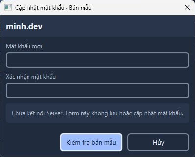

*Hình 13. Hai ô mật khẩu và nút kiểm tra tính hợp lệ; ghi rõ chưa kết nối Server, không lưu hoặc cập nhật mật khẩu.*

### 4.5. Lịch sử cá nhân

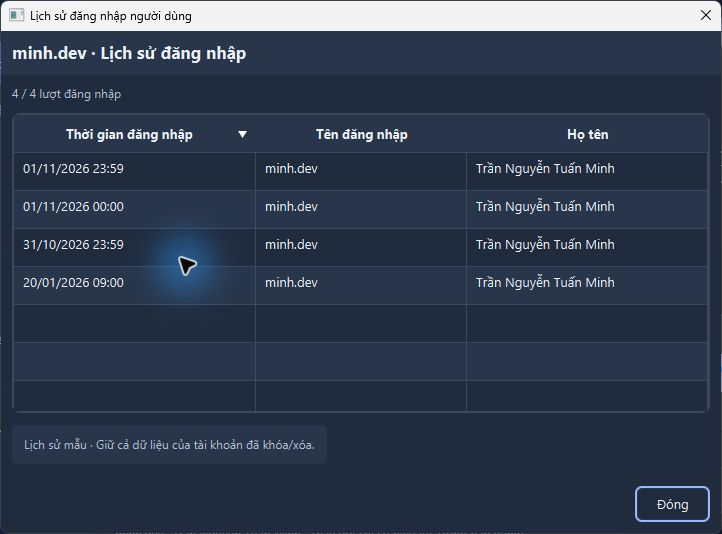

*Hình 14. `minh.dev` có 4 lượt đăng nhập; dữ liệu khớp lịch sử chung theo cùng ID.*

### 4.6. Bạn bè cá nhân

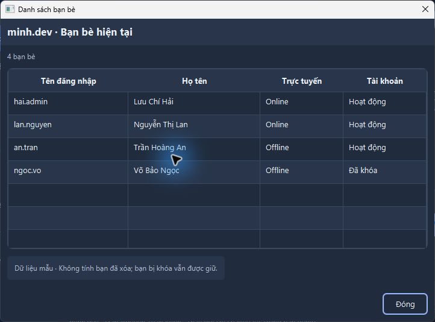

*Hình 15. `minh.dev` có 4 bạn trực tiếp, gồm cả tài khoản đã khóa; trạng thái online/offline là dữ liệu mẫu.*

### 4.7. Thành viên và Admin nhóm

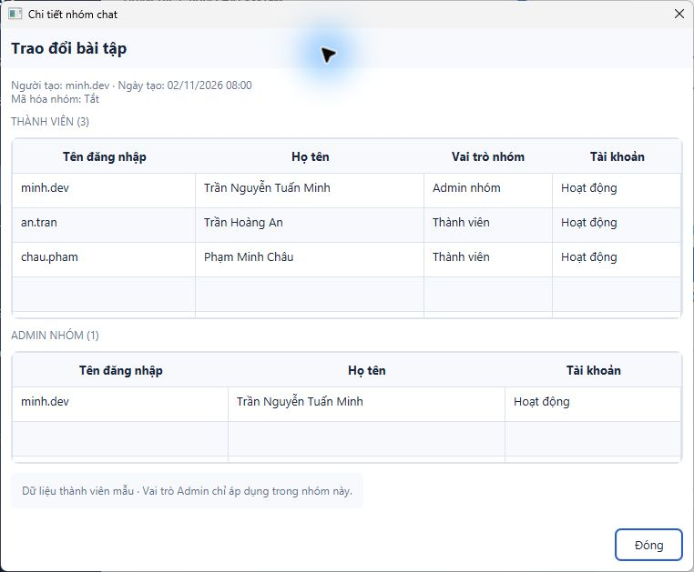

*Hình 16. Nhóm Trao đổi bài tập có 3 thành viên và 1 Admin nhóm. Quyền Admin nhóm độc lập với quyền Admin hệ thống.*

### 4.8. Xác nhận khóa từ báo cáo

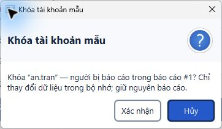

*Hình 17. Ghi đúng đối tượng `an.tran` và báo cáo #1; Hủy là lựa chọn mặc định. Phiên chụp đã Hủy thao tác.*

### 4.9. Theme tối

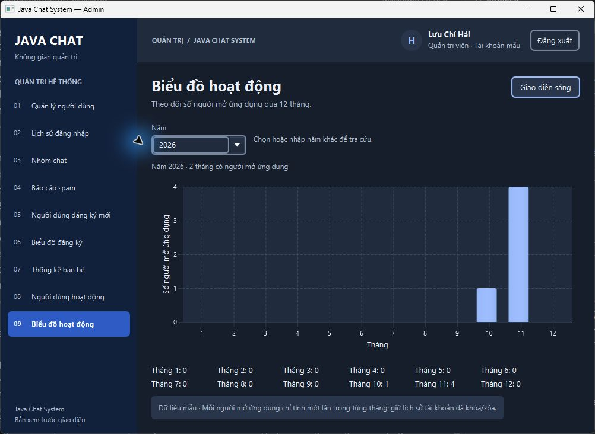

*Hình 18. Cùng số liệu Hình 9, sử dụng bảng màu tối chung của Admin.*

## 5. Kết quả và giới hạn của bản mẫu

Tại lần kiểm chứng ngày 16/11/2026, bộ kiểm tra đạt 45 trường hợp store A2, 88 trường hợp logic thống kê, 28 trường hợp dữ liệu mẫu và 706 trường hợp JavaFX. Các số đếm thuộc các bộ kiểm tra có phần phạm vi giao nhau, không dùng làm số lượng chức năng đã hoàn thành. Kiểm tra trực quan gồm hai theme, form/dialog, bàn phím và cửa sổ chuẩn/phóng to theo [checklist T00–T19](implementation-tasks.md).

Bản mẫu chuẩn giữ 10 hồ sơ, 11 lượt đăng nhập, 9 cặp bạn, 3 nhóm, 11 thành viên nhóm, 3 báo cáo và 15 sự kiện hoạt động. Dữ liệu chuẩn hiện chỉ có năm 2026; bộ kiểm thử riêng dùng Clock và sự kiện hợp lệ để kiểm chứng hai năm. Không đưa sự kiện tương lai vào phiên chuẩn để tạo ảnh. Thống kê và trạng thái online trong ảnh không phải dữ liệu vận hành thật.

Phần còn lại ở giai đoạn tiếp theo gồm TCP Server, JDBC, xác thực/phân quyền thực tế, dữ liệu lưu bền vững, email và mã hóa. Không dùng kết quả UI hoặc SQL riêng lẻ để khẳng định các luồng này đã hoàn tất.

## 6. Ghi chú ghép báo cáo chung

Mục này là hướng dẫn bàn giao, không cần đưa nguyên văn vào bản nộp:

- Dùng mục 2 cho phần Thiết kế CSDL; dùng mục 3–4 cho Danh sách màn hình. Giữ chú thích dữ liệu mẫu và giới hạn của bản 20%.
- ERD là bản trích nguyên nguồn Mermaid; khi chuyển sang Word/PDF cần render sơ đồ và kiểm tra đọc được đủ tên bảng/khóa. Có thể đặt ERD ở trang ngang hoặc phụ lục, không chụp thu nhỏ đến mức không đọc được chữ.
- Ghép thêm thông tin nhóm, danh sách công việc từng thành viên và bảng đóng góp tổng 100% theo thống nhất thực tế. Không tự coi 50/50 là tỷ lệ đã xác nhận.
- Bổ sung phần User và ảnh của Minh; ảnh commit Hải hiện có tại [minh chứng Git T21](git-evidence.md), kèm giới hạn phiên bản. Cần ảnh riêng của Minh và cập nhật ảnh Hải khi chốt các commit còn lại. 18 ảnh giao diện ở đây không thay thế ảnh Git.
- Chỉ lấy `database.sql` vào thư mục script của bộ nộp theo kế hoạch; các test SQL phục vụ phát triển. Chưa xuất hoặc ghi đè `BaoCao.pdf`, chưa đóng gói ZIP hoặc gửi cho Minh trong T20.
- Sau khi ghép, kiểm tra lại đủ 5 mục bắt buộc trên trang 4 của đề. Đánh số hình/mục lại theo toàn bộ báo cáo, tránh trùng số với phần User.
