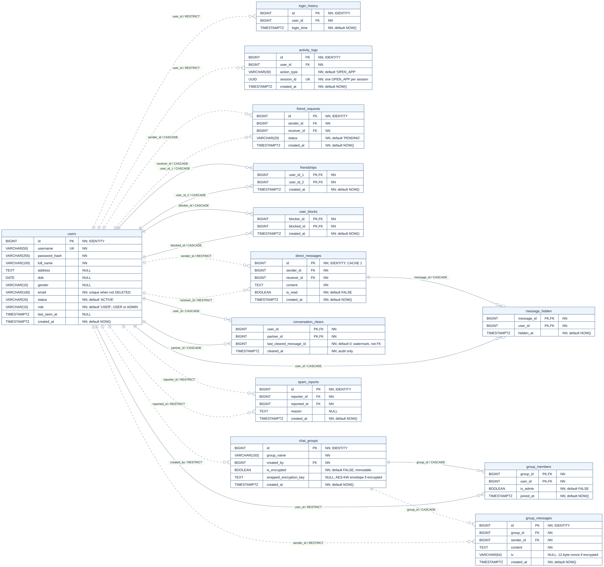

# TÀI LIỆU CƠ SỞ DỮ LIỆU TOÀN DIỆN — JAVA CHAT SYSTEM

> **Phiên bản:** 3.1 (Unified Architecture & Implementation Guide).  
> **Hệ quản trị CSDL:** PostgreSQL 16+ (Local port 5432).  
> **Quy mô:** 13 bảng, 65 cột, 21 khóa ngoại (FK), 17 chỉ mục (Index) tường minh, 31 ràng buộc CHECK, 2 triggers bảo vệ tính toàn vẹn.
> **Tệp DDL thực thi:** `script/database.sql` (Chạy tạo CSDL từ database rỗng).

---

## 1. Sơ đồ Quan hệ Thực thể (ERD — Entity Relationship Diagram)



---

## 2. Đặc tả Cấu trúc 13 Bảng & Ràng buộc

### Nhóm 1: Quản lý Người dùng & Hoạt động (3 bảng)

#### 1. Bảng `users` (Hồ sơ người dùng & Phân quyền)
| Tên cột | Kiểu dữ liệu | Nullable | Ràng buộc / Mặc định | Ý nghĩa |
| :--- | :--- | :--- | :--- | :--- |
| `id` | `BIGINT` | `NOT NULL` | `GENERATED ALWAYS AS IDENTITY PRIMARY KEY` | Khóa chính tự tăng |
| `username` | `VARCHAR(50)` | `NOT NULL` | `UNIQUE` | Tên đăng nhập duy nhất |
| `password_hash` | `VARCHAR(255)` | `NOT NULL` | | Chuỗi băm mật khẩu BCrypt |
| `full_name` | `VARCHAR(100)` | `NOT NULL` | | Họ và tên hiển thị |
| `address` | `TEXT` | `NULL` | | Địa chỉ |
| `dob` | `DATE` | `NULL` | | Ngày sinh |
| `gender` | `VARCHAR(10)` | `NULL` | `CHECK (gender IN ('MALE', 'FEMALE', 'OTHER'))` | Giới tính |
| `email` | `VARCHAR(100)` | `NOT NULL` | Unique partial index `uq_users_email_not_deleted`, `WHERE status <> 'DELETED'` | Email chuẩn hóa, duy nhất giữa các tài khoản `ACTIVE`/`LOCKED` |
| `status` | `VARCHAR(20)` | `NOT NULL` | `DEFAULT 'ACTIVE'`, `CHECK (status IN ('ACTIVE', 'LOCKED', 'DELETED'))` | Trạng thái tài khoản |
| `role` | `VARCHAR(10)` | `NOT NULL` | `DEFAULT 'USER'`, `CHECK (role IN ('USER', 'ADMIN'))` | Phân quyền truy cập UI |
| `last_seen_at` | `TIMESTAMPTZ` | `NULL` | | Thời điểm hoạt động cuối |
| `created_at` | `TIMESTAMPTZ` | `NOT NULL` | `DEFAULT NOW()` | Thời điểm tạo tài khoản |

#### 2. Bảng `login_history` (Lịch sử đăng nhập)
| Tên cột | Kiểu dữ liệu | Nullable | Ràng buộc / Mặc định | Ý nghĩa |
| :--- | :--- | :--- | :--- | :--- |
| `id` | `BIGINT` | `NOT NULL` | `GENERATED ALWAYS AS IDENTITY PRIMARY KEY` | Khóa chính tự tăng |
| `user_id` | `BIGINT` | `NOT NULL` | `REFERENCES users(id) ON DELETE RESTRICT` | Người dùng đăng nhập |
| `login_time` | `TIMESTAMPTZ` | `NOT NULL` | `DEFAULT NOW()` | Thời điểm đăng nhập |

#### 3. Bảng `activity_logs` (Nhật ký mở ứng dụng theo phiên)
| Tên cột | Kiểu dữ liệu | Nullable | Ràng buộc / Mặc định | Ý nghĩa |
| :--- | :--- | :--- | :--- | :--- |
| `id` | `BIGINT` | `NOT NULL` | `GENERATED ALWAYS AS IDENTITY PRIMARY KEY` | Khóa chính tự tăng |
| `user_id` | `BIGINT` | `NOT NULL` | `REFERENCES users(id) ON DELETE RESTRICT` | Người dùng thực hiện |
| `action_type` | `VARCHAR(30)` | `NOT NULL` | `DEFAULT 'OPEN_APP'`, `CHECK (action_type IN ('OPEN_APP'))` | Loại hành động |
| `session_id` | `UUID` | `NOT NULL` | `UNIQUE` | Khóa chống trùng lặp phiên (Idempotency key) |
| `created_at` | `TIMESTAMPTZ` | `NOT NULL` | `DEFAULT NOW()` | Thời điểm mở ứng dụng |

---

### Nhóm 2: Bạn bè & Chặn người dùng (3 bảng)

#### 4. Bảng `friend_requests` (Lời mời kết bạn)
| Tên cột | Kiểu dữ liệu | Nullable | Ràng buộc / Mặc định | Ý nghĩa |
| :--- | :--- | :--- | :--- | :--- |
| `id` | `BIGINT` | `NOT NULL` | `GENERATED ALWAYS AS IDENTITY PRIMARY KEY` | Khóa chính tự tăng |
| `sender_id` | `BIGINT` | `NOT NULL` | `REFERENCES users(id) ON DELETE CASCADE` | Người gửi lời mời |
| `receiver_id` | `BIGINT` | `NOT NULL` | `REFERENCES users(id) ON DELETE CASCADE` | Người nhận lời mời |
| `status` | `VARCHAR(20)` | `NOT NULL` | `DEFAULT 'PENDING'`, `CHECK (status IN ('PENDING', 'ACCEPTED', 'REJECTED'))` | Trạng thái lời mời |
| `created_at` | `TIMESTAMPTZ` | `NOT NULL` | `DEFAULT NOW()` | Thời điểm gửi |
- **Ràng buộc:** `CHECK (sender_id <> receiver_id)`.
- **Chỉ mục chống trùng gửi 2 chiều:** `UNIQUE INDEX uq_pending_friend_pair ON friend_requests (LEAST(sender_id, receiver_id), GREATEST(sender_id, receiver_id)) WHERE status = 'PENDING'`.

#### 5. Bảng `friendships` (Quan hệ bạn bè chính thức)
| Tên cột | Kiểu dữ liệu | Nullable | Ràng buộc / Mặc định | Ý nghĩa |
| :--- | :--- | :--- | :--- | :--- |
| `user_id_1` | `BIGINT` | `NOT NULL` | `REFERENCES users(id) ON DELETE CASCADE` | ID người dùng nhỏ hơn |
| `user_id_2` | `BIGINT` | `NOT NULL` | `REFERENCES users(id) ON DELETE CASCADE` | ID người dùng lớn hơn |
| `created_at` | `TIMESTAMPTZ` | `NOT NULL` | `DEFAULT NOW()` | Thời điểm kết bạn |
- **Khóa chính:** `PRIMARY KEY (user_id_1, user_id_2)`.
- **Ràng buộc chuẩn hóa:** `CHECK (user_id_1 < user_id_2)`.

#### 6. Bảng `user_blocks` (Danh sách chặn tài khoản)
| Tên cột | Kiểu dữ liệu | Nullable | Ràng buộc / Mặc định | Ý nghĩa |
| :--- | :--- | :--- | :--- | :--- |
| `blocker_id` | `BIGINT` | `NOT NULL` | `REFERENCES users(id) ON DELETE CASCADE` | Người thực hiện chặn |
| `blocked_id` | `BIGINT` | `NOT NULL` | `REFERENCES users(id) ON DELETE CASCADE` | Người bị chặn |
| `created_at` | `TIMESTAMPTZ` | `NOT NULL` | `DEFAULT NOW()` | Thời điểm chặn |
- **Khóa chính:** `PRIMARY KEY (blocker_id, blocked_id)`.
- **Ràng buộc:** `CHECK (blocker_id <> blocked_id)`.

---

### Nhóm 3: Tin nhắn Cá nhân (1-1) & Xóa Lịch sử (3 bảng)

#### 7. Bảng `direct_messages` (Tin nhắn trực tiếp 1-1)
| Tên cột | Kiểu dữ liệu | Nullable | Ràng buộc / Mặc định | Ý nghĩa |
| :--- | :--- | :--- | :--- | :--- |
| `id` | `BIGINT` | `NOT NULL` | `GENERATED ALWAYS AS IDENTITY (CACHE 1) PRIMARY KEY` | Khóa chính tự tăng tuần tự |
| `sender_id` | `BIGINT` | `NOT NULL` | `REFERENCES users(id) ON DELETE RESTRICT` | Người gửi tin |
| `receiver_id` | `BIGINT` | `NOT NULL` | `REFERENCES users(id) ON DELETE RESTRICT` | Người nhận tin |
| `content` | `TEXT` | `NOT NULL` | | Nội dung tin nhắn văn bản |
| `is_read` | `BOOLEAN` | `NOT NULL` | `DEFAULT FALSE` | Cờ đã xem tin nhắn |
| `created_at` | `TIMESTAMPTZ` | `NOT NULL` | `DEFAULT NOW()` | Thời điểm gửi |
- **Ràng buộc:** `CHECK (sender_id <> receiver_id)`.

#### 8. Bảng `message_hidden` (Xóa lẻ 1 hoặc vài dòng tin nhắn)
| Tên cột | Kiểu dữ liệu | Nullable | Ràng buộc / Mặc định | Ý nghĩa |
| :--- | :--- | :--- | :--- | :--- |
| `message_id` | `BIGINT` | `NOT NULL` | `REFERENCES direct_messages(id) ON DELETE CASCADE` | Tin nhắn bị ẩn |
| `user_id` | `BIGINT` | `NOT NULL` | `REFERENCES users(id) ON DELETE CASCADE` | Người thực hiện ẩn phía mình |
| `hidden_at` | `TIMESTAMPTZ` | `NOT NULL` | `DEFAULT NOW()` | Thời điểm ẩn |
- **Khóa chính:** `PRIMARY KEY (message_id, user_id)`.

#### 9. Bảng `conversation_clears` (Mốc xóa toàn bộ cuộc trò chuyện 1 phía)
| Tên cột | Kiểu dữ liệu | Nullable | Ràng buộc / Mặc định | Ý nghĩa |
| :--- | :--- | :--- | :--- | :--- |
| `user_id` | `BIGINT` | `NOT NULL` | `REFERENCES users(id) ON DELETE CASCADE` | Người bấm xóa lịch sử |
| `partner_id` | `BIGINT` | `NOT NULL` | `REFERENCES users(id) ON DELETE CASCADE` | Người đối thoại trong cuộc chat |
| `last_cleared_message_id` | `BIGINT` | `NOT NULL` | `DEFAULT 0`, `CHECK (last_cleared_message_id >= 0)` | Mốc ID tin nhắn cao nhất đã xóa |
| `cleared_at` | `TIMESTAMPTZ` | `NOT NULL` | | Thời điểm xóa (dùng audit/hiển thị) |
- **Khóa chính:** `PRIMARY KEY (user_id, partner_id)`.
- **Ràng buộc:** `CHECK (user_id <> partner_id)`.

---

### Nhóm 4: Nhóm chat & Mã hóa (3 bảng)

#### 10. Bảng `chat_groups` (Nhóm chat)
| Tên cột | Kiểu dữ liệu | Nullable | Ràng buộc / Mặc định | Ý nghĩa |
| :--- | :--- | :--- | :--- | :--- |
| `id` | `BIGINT` | `NOT NULL` | `GENERATED ALWAYS AS IDENTITY PRIMARY KEY` | Khóa chính tự tăng |
| `group_name` | `VARCHAR(100)` | `NOT NULL` | | Tên nhóm chat |
| `created_by` | `BIGINT` | `NOT NULL` | `REFERENCES users(id) ON DELETE RESTRICT` | Người tạo nhóm |
| `is_encrypted` | `BOOLEAN` | `NOT NULL` | `DEFAULT FALSE` | Cờ kích hoạt mã hóa AES-GCM (Bất biến) |
| `wrapped_encryption_key` | `TEXT` | `NULL` | | Envelope khóa DEK bọc bởi KEK |
| `created_at` | `TIMESTAMPTZ` | `NOT NULL` | `DEFAULT NOW()` | Thời điểm tạo nhóm |
- **Ràng buộc:** `CHECK ((is_encrypted AND wrapped_encryption_key IS NOT NULL) OR (NOT is_encrypted AND wrapped_encryption_key IS NULL))`.

#### 11. Bảng `group_members` (Thành viên nhóm chat)
| Tên cột | Kiểu dữ liệu | Nullable | Ràng buộc / Mặc định | Ý nghĩa |
| :--- | :--- | :--- | :--- | :--- |
| `group_id` | `BIGINT` | `NOT NULL` | `REFERENCES chat_groups(id) ON DELETE CASCADE` | Nhóm chat tham gia |
| `user_id` | `BIGINT` | `NOT NULL` | `REFERENCES users(id) ON DELETE RESTRICT` | Thành viên tham gia |
| `is_admin` | `BOOLEAN` | `NOT NULL` | `DEFAULT FALSE` | Quyền Admin trong nhóm chat |
| `joined_at` | `TIMESTAMPTZ` | `NOT NULL` | `DEFAULT NOW()` | Thời điểm gia nhập nhóm |
- **Khóa chính:** `PRIMARY KEY (group_id, user_id)`.

#### 12. Bảng `group_messages` (Tin nhắn trong nhóm chat)
| Tên cột | Kiểu dữ liệu | Nullable | Ràng buộc / Mặc định | Ý nghĩa |
| :--- | :--- | :--- | :--- | :--- |
| `id` | `BIGINT` | `NOT NULL` | `GENERATED ALWAYS AS IDENTITY PRIMARY KEY` | Khóa chính tự tăng |
| `group_id` | `BIGINT` | `NOT NULL` | `REFERENCES chat_groups(id) ON DELETE CASCADE` | Nhóm nhận tin nhắn |
| `sender_id` | `BIGINT` | `NOT NULL` | `REFERENCES users(id) ON DELETE RESTRICT` | Thành viên gửi tin |
| `content` | `TEXT` | `NOT NULL` | | Plaintext UTF-8 hoặc Base64(Ciphertext\|\|Tag) |
| `iv` | `VARCHAR(64)` | `NULL` | | Base64 của IV 12 byte (Null nếu nhóm thường) |
| `created_at` | `TIMESTAMPTZ` | `NOT NULL` | `DEFAULT NOW()` | Thời điểm gửi tin |
- **Ràng buộc:** `CHECK (iv IS NULL OR iv ~ '^[A-Za-z0-9+/]{16}$')`.
- **Chỉ mục duy nhất:** `UNIQUE (group_id, iv) WHERE iv IS NOT NULL`.

---

### Nhóm 5: Báo cáo Spam (1 bảng)

#### 13. Bảng `spam_reports` (Báo cáo vi phạm / làm phiền)
| Tên cột | Kiểu dữ liệu | Nullable | Ràng buộc / Mặc định | Ý nghĩa |
| :--- | :--- | :--- | :--- | :--- |
| `id` | `BIGINT` | `NOT NULL` | `GENERATED ALWAYS AS IDENTITY PRIMARY KEY` | Khóa chính tự tăng |
| `reporter_id` | `BIGINT` | `NOT NULL` | `REFERENCES users(id) ON DELETE RESTRICT` | Người gửi báo cáo |
| `reported_id` | `BIGINT` | `NOT NULL` | `REFERENCES users(id) ON DELETE RESTRICT` | Người bị báo cáo vi phạm |
| `reason` | `TEXT` | `NULL` | | Lý do báo cáo |
| `created_at` | `TIMESTAMPTZ` | `NOT NULL` | `DEFAULT NOW()` | Thời điểm tạo báo cáo |
- **Ràng buộc:** `CHECK (reporter_id <> reported_id)`.

---

## 3. Danh sách Chỉ mục (Indexes) & Triggers

### 3.1 Chỉ mục Tường minh hỗ trợ Tối ưu Truy vấn
- `uq_users_email_not_deleted`: `users(email) WHERE status <> 'DELETED'` — Một email chỉ thuộc tối đa một tài khoản chưa xóa; các hồ sơ `DELETED` có thể cùng email.
- `idx_login_history_time`: `login_history(login_time DESC)` — Xem lịch sử đăng nhập theo thời gian.
- `idx_login_history_user_time`: `login_history(user_id, login_time DESC)` — Lịch sử đăng nhập của người dùng được chọn.
- `idx_activity_time_user`: `activity_logs(created_at, user_id)` — Lọc hoạt động theo thời gian.
- `idx_activity_user_time`: `activity_logs(user_id, created_at)` — Hoạt động của từng người dùng.
- `uq_pending_friend_pair`: `friend_requests(LEAST(sender_id, receiver_id), GREATEST(sender_id, receiver_id)) WHERE status = 'PENDING'` — Chống lặp lời mời kết bạn 2 chiều.
- `idx_friend_requests_inbox`: `friend_requests(receiver_id, created_at DESC) WHERE status = 'PENDING'` — Lời mời đang chờ xử lý.
- `idx_friendships_second`: `friendships(user_id_2, user_id_1)` — Tra cứu bạn bè từ đầu thứ hai của quan hệ.
- `idx_dm_pair_id`: `direct_messages(LEAST(sender_id, receiver_id), GREATEST(sender_id, receiver_id), id)` — Tải lịch sử chat 1-1 cực nhanh theo mốc watermark.
- `idx_dm_sender_time`: `direct_messages(sender_id, created_at, receiver_id)` — Thống kê tin nhắn gửi đi.
- `idx_dm_receiver_id`: `direct_messages(receiver_id, id)` — Tra cứu tin nhắn nhận.
- `idx_group_members_user`: `group_members(user_id, group_id)` — Nhóm có người dùng tham gia.
- `idx_group_messages_time`: `group_messages(group_id, created_at, id)` — Tải lịch sử chat nhóm theo thời gian.
- `idx_group_messages_sender_time`: `group_messages(sender_id, created_at, group_id)` — Thống kê tin nhắn nhóm đã gửi.
- `uq_group_message_iv`: `group_messages(group_id, iv) WHERE iv IS NOT NULL` — Chống tái sử dụng Nonce AES-GCM.
- `idx_spam_reports_time`: `spam_reports(created_at DESC)` — Admin xem báo cáo spam mới nhất.
- `idx_users_created_at`: `users(created_at)` — Lọc và thống kê thời gian đăng ký.

Ngoài 17 chỉ mục tường minh, 13 khóa chính và 3 ràng buộc `UNIQUE` (`username`, `session_id`, cặp báo cáo spam) tạo thêm 16 chỉ mục; tổng cộng 33 chỉ mục trên các bảng ứng dụng.

### 3.2 Triggers Bảo vệ Toàn vẹn Dữ liệu
1. `trg_group_mode_immutable`: Ngăn chặn tuyệt đối việc thay đổi cờ `is_encrypted` của nhóm sau khi tạo.
2. `trg_group_message_mode`: Đảm bảo tin nhắn nhóm gửi vào phải khớp đúng chế độ mã hóa (nhóm mã hóa bắt buộc có IV hợp lệ, nhóm thường IV phải NULL).

---

## 4. Cẩm nang Vận hành & Lập trình Tầng Server (Backend Implementation Guide)

### 4.1 Xác thực & Quản lý Phiên Mở Ứng Dụng
- **Đăng ký:** Mật khẩu băm BCrypt (`BCrypt.hashpw`), gán cố định `role = 'USER'`.
- **Đăng nhập:** Kiểm tra BCrypt, kiểm tra `status = 'ACTIVE'`, phân quyền theo `role` (Admin UI chỉ cho phép `role = 'ADMIN'`).
- **Ghi nhận `OPEN_APP` không trùng lặp:**
  - Client sinh UUID v4 (`session_id`) lưu trong bộ nhớ tiến trình của phiên làm việc.
  - Server thực thi:
    ```sql
    INSERT INTO activity_logs (user_id, action_type, session_id, created_at)
    VALUES (?, 'OPEN_APP', ?, NOW())
    ON CONFLICT (session_id) DO NOTHING;
    ```
  - Khi Socket reconnect, Client gửi lại UUID cũ. Nhờ `ON CONFLICT DO NOTHING`, DB tự động bỏ qua, đảm bảo thống kê mở app chính xác 100%.

### 4.2 Nghiệp vụ Bạn bè & Chặn (Block)
- **Đồng ý kết bạn (`ACCEPT`):** Thực hiện trong **một Transaction**:
  ```sql
  UPDATE friend_requests SET status = 'ACCEPTED' WHERE id = ? AND receiver_id = ? AND status = 'PENDING';
  INSERT INTO friendships (user_id_1, user_id_2, created_at)
  VALUES (LEAST(?, ?), GREATEST(?, ?), NOW())
  ON CONFLICT (user_id_1, user_id_2) DO NOTHING;
  ```
- **Chặn tài khoản (`BLOCK`):** Thực hiện trong **một Transaction**:
  ```sql
  INSERT INTO user_blocks (blocker_id, blocked_id, created_at) VALUES (?, ?, NOW()) ON CONFLICT DO NOTHING;
  DELETE FROM friendships WHERE user_id_1 = LEAST(?, ?) AND user_id_2 = GREATEST(?, ?);
  UPDATE friend_requests SET status = 'REJECTED'
  WHERE ((sender_id = ? AND receiver_id = ?) OR (sender_id = ? AND receiver_id = ?)) AND status = 'PENDING';
  ```
- **Tìm kiếm người dùng:** Loại trừ những người đã chặn mình:
  ```sql
  SELECT id, username, full_name, last_seen_at FROM users
  WHERE status = 'ACTIVE' AND id != :my_id
    AND (LOWER(username) LIKE LOWER(:keyword) OR LOWER(full_name) LIKE LOWER(:keyword))
    AND id NOT IN (SELECT blocker_id FROM user_blocks WHERE blocked_id = :my_id);
  ```

### 4.3 Tin nhắn Cá nhân 1-1 & Cơ chế Xóa Lịch sử
- **Đồng bộ bằng Advisory Lock:** Server băm cặp `(min_id, max_id)` thành số `BIGINT` dương và gọi `SELECT pg_advisory_xact_lock(:dm_lock_key);` trước khi gửi hoặc xóa tin.
- **Xóa toàn bộ lịch sử 1 phía:** Ghi mốc watermark `MAX(id)` tại thời điểm xóa:
  ```sql
  SELECT COALESCE(MAX(id), 0) AS cutoff FROM direct_messages
  WHERE (sender_id = :user_id AND receiver_id = :partner_id) OR (sender_id = :partner_id AND receiver_id = :user_id);

  INSERT INTO conversation_clears (user_id, partner_id, last_cleared_message_id, cleared_at)
  VALUES (:user_id, :partner_id, :cutoff, clock_timestamp())
  ON CONFLICT (user_id, partner_id) DO UPDATE SET
    last_cleared_message_id = GREATEST(conversation_clears.last_cleared_message_id, EXCLUDED.last_cleared_message_id),
    cleared_at = EXCLUDED.cleared_at;
  ```
- **Xóa lẻ 1/vài dòng:** Ghi nhận vào `message_hidden`:
  ```sql
  INSERT INTO message_hidden (message_id, user_id, hidden_at) VALUES (?, :my_id, NOW()) ON CONFLICT DO NOTHING;
  ```
- **Tải lịch sử chat hiển thị cho người dùng:** Chỉ lấy tin nhắn sau mốc watermark và chưa bị ẩn:
  ```sql
  SELECT m.id, m.sender_id, m.receiver_id, m.content, m.is_read, m.created_at
  FROM direct_messages m
  LEFT JOIN conversation_clears c ON c.user_id = :my_id AND c.partner_id = :partner_id
  WHERE ((m.sender_id = :my_id AND m.receiver_id = :partner_id) OR (m.sender_id = :partner_id AND m.receiver_id = :my_id))
    AND m.id > COALESCE(c.last_cleared_message_id, 0)
    AND NOT EXISTS (SELECT 1 FROM message_hidden h WHERE h.message_id = m.id AND h.user_id = :my_id)
  ORDER BY m.id ASC;
  ```

### 4.4 Nhóm Chat & Mã hóa AES-GCM Server-side
- **Tạo nhóm:** Nếu nhóm mã hóa, Server sinh khóa DEK (AES-256), bọc (wrap) bằng Master Key KEK bên ngoài DB (`AESWrap`), lưu chuỗi envelope vào `chat_groups.wrapped_encryption_key`. Thêm người tạo làm Admin đầu tiên vào `group_members`.
- **Gửi tin:** Server sinh IV 12 byte ngẫu nhiên (Base64 16 ký tự), mã hóa nội dung bằng `AES/GCM/NoPadding` với DEK của nhóm, chèn vào `group_messages`.

### 4.5 Các câu Truy vấn Thống kê Phức tạp cho Admin
- **Bạn của bạn (Friend-of-Friends — Yêu cầu 7):** Đếm số bạn bậc 2, loại trừ chính mình và bạn trực tiếp:
  ```sql
  WITH direct_friends AS (
      SELECT user_id_1 AS u_id, user_id_2 AS friend_id FROM friendships
      UNION
      SELECT user_id_2 AS u_id, user_id_1 AS friend_id FROM friendships
  ),
  fof_raw AS (
      SELECT df1.u_id AS user_id, df2.friend_id AS fof_id
      FROM direct_friends df1
      JOIN direct_friends df2 ON df1.friend_id = df2.u_id
      WHERE df2.friend_id != df1.u_id
        AND df2.friend_id NOT IN (SELECT friend_id FROM direct_friends WHERE u_id = df1.u_id)
  )
  SELECT u.id, u.username, u.full_name, u.created_at,
         COUNT(DISTINCT df.friend_id) AS direct_friends_count,
         COUNT(DISTINCT fof.fof_id) AS friends_of_friends_count
  FROM users u
  LEFT JOIN direct_friends df ON u.id = df.u_id
  LEFT JOIN fof_raw fof ON u.id = fof.user_id
  WHERE u.status != 'DELETED'
  GROUP BY u.id, u.username, u.full_name, u.created_at
  ORDER BY u.created_at DESC;
  ```
- **Người dùng hoạt động trong khoảng thời gian (Yêu cầu 8):** Đếm lượt mở app, số người đã chat, số nhóm đã chat:
  ```sql
  SELECT u.id, u.username, u.full_name,
         COALESCE(act.open_app_count, 0) AS open_app_count,
         COALESCE(dm.chat_partners_count, 0) AS chat_partners_count,
         COALESCE(gm.chat_groups_count, 0) AS chat_groups_count
  FROM users u
  LEFT JOIN (
      SELECT user_id, COUNT(*) AS open_app_count FROM activity_logs
      WHERE action_type = 'OPEN_APP' AND created_at >= :from_time AND created_at < :to_time GROUP BY user_id
  ) act ON u.id = act.user_id
  LEFT JOIN (
      SELECT sender_id, COUNT(DISTINCT receiver_id) AS chat_partners_count FROM direct_messages
      WHERE created_at >= :from_time AND created_at < :to_time GROUP BY sender_id
  ) dm ON u.id = dm.sender_id
  LEFT JOIN (
      SELECT sender_id, COUNT(DISTINCT group_id) AS chat_groups_count FROM group_messages
      WHERE created_at >= :from_time AND created_at < :to_time GROUP BY sender_id
  ) gm ON u.id = gm.sender_id
  WHERE (COALESCE(act.open_app_count, 0) > 0 OR COALESCE(dm.chat_partners_count, 0) > 0 OR COALESCE(gm.chat_groups_count, 0) > 0)
  ORDER BY u.id ASC;
  ```
- **Biểu đồ 12 tháng theo năm (Yêu cầu 9):**
  ```sql
  WITH months AS (
      SELECT generate_series(
          DATE_TRUNC('year', :chosen_year_date::timestamptz),
          DATE_TRUNC('year', :chosen_year_date::timestamptz) + interval '11 months',
          interval '1 month'
      ) AS m_start
  )
  SELECT EXTRACT(MONTH FROM m.m_start)::int AS month, COUNT(DISTINCT a.user_id) AS active_users_count
  FROM months m
  LEFT JOIN activity_logs a ON a.action_type = 'OPEN_APP' AND a.created_at >= m.m_start AND a.created_at < m.m_start + interval '1 month'
  GROUP BY m.m_start ORDER BY m.m_start ASC;
  ```

### 4.6 Cơ chế Bảo vệ Tài khoản Admin Cuối cùng
```sql
BEGIN;
SELECT pg_advisory_xact_lock(-1::bigint);
UPDATE users SET role = :new_role, status = :new_status WHERE id = :target_id;
SELECT COUNT(*) FROM users WHERE role = 'ADMIN' AND status = 'ACTIVE';
-- NẾU count < 1: Thực thi ROLLBACK và trả lỗi "Không thể khóa/hạ quyền Admin hoạt động cuối cùng của hệ thống!"
-- NẾU count >= 1: Thực thi COMMIT;
```

### 4.7 Email và Xóa mềm Tài khoản

- Email được chuẩn hóa thành chữ thường, bỏ khoảng trắng đầu/cuối; giữ các ràng buộc `NOT NULL`, không rỗng và ASCII trong DDL.
- `uq_users_email_not_deleted` bảo đảm tối đa một tài khoản `ACTIVE` hoặc `LOCKED` giữ một email. Không dùng `UNIQUE(email)` trên toàn bộ bảng.
- Hồ sơ `DELETED` giữ nguyên ID, username, email và ngày tạo; có thể có nhiều hồ sơ đã xóa cùng email. Username vẫn duy nhất trên toàn bảng, kể cả hồ sơ đã xóa.
- Xóa mềm chỉ đổi trạng thái, không xóa bản ghi hoặc chuyển lịch sử sang người dùng khác. Tài khoản mới luôn có ID mới.
- Admin A2 mô phỏng cùng quy tắc email trong bộ nhớ. Đây chưa phải luồng đăng ký hoặc khôi phục tài khoản chạy qua Server/PostgreSQL.
- Đăng nhập và quên mật khẩu phải chọn tài khoản đủ điều kiện `status = 'ACTIVE'`; nếu tìm bằng email, không lấy tùy ý bản ghi đầu tiên. Sau khi chọn, cập nhật theo ID và kiểm tra lại trạng thái/email phù hợp trong thao tác cập nhật. Không khôi phục hoặc mở khóa ngầm qua luồng quên mật khẩu.
- Kiểm tra email ở Client chỉ hỗ trợ phản hồi; Server phải xử lý lỗi duy nhất SQLSTATE `23505` do DB trả về. Không dùng riêng `SELECT` rồi `INSERT` để thay thế ràng buộc duy nhất, và không dùng `ON CONFLICT (email)` như khi có ràng buộc duy nhất toàn bảng.
- `DELETED` vẫn là trạng thái kết thúc trong nghiệp vụ hiện tại: không sửa hồ sơ, không khôi phục. DDL không tự thi hành quy tắc kết thúc hay thu hồi phiên; đây là trách nhiệm của Server.

### 4.8 Kiểm thử Ràng buộc Email

[`script/tests/email-uniqueness.sql`](../../script/tests/email-uniqueness.sql) kiểm tra hành vi email trên PostgreSQL, chỉ nhận database dùng riêng có tên dạng `java_chat_email_test_` nối với 12 ký tự hex và bảng `users` rỗng. Kiểm thử chạy trong transaction rồi `ROLLBACK`; không chạy trên database ứng dụng đang sử dụng.

Tạo database kiểm thử mới bằng công cụ PostgreSQL, áp dụng DDL từ gốc repository rồi chạy:

```powershell
psql -X -w -v ON_ERROR_STOP=1 -d java_chat_email_test_0123456789ab -f script/database.sql
psql -X -w -v ON_ERROR_STOP=1 -d java_chat_email_test_0123456789ab -f script/tests/email-uniqueness.sql
```

Điều chỉnh host/port/user theo môi trường; dùng cơ chế xác thực PostgreSQL cục bộ, không ghi mật khẩu vào lệnh hay repository. Chỉ xóa database kiểm thử do mình vừa tạo sau khi kiểm tra tên đích. `script/database.sql` chỉ dành cho database rỗng, không dùng để nâng cấp database đã có dữ liệu. Khi đóng gói bài nộp, `script/` của gói nộp chỉ lấy `database.sql`; bộ kiểm thử phục vụ phát triển.

**Minh chứng ngày 02/11/2026:** áp dụng toàn bộ `database.sql` trên database kiểm thử mới bằng PostgreSQL 18.6; **25 kiểm tra SQL PASS**, dữ liệu kiểm thử rollback và database kiểm thử đã được dọn. Bộ `src/admin/check-users.ps1` **45 PASS**, Maven compile thành công. Đây là kết quả kiểm tra ràng buộc SQL và store mẫu, chưa phải kiểm thử đăng ký/quên mật khẩu qua Server; không áp dụng DDL vào database ứng dụng hiện có.

## 5. Tính năng Có thể Phát triển trong Tương lai

Các mục dưới đây không phải chức năng bắt buộc trong PDF và chưa được triển khai thành luồng hoàn chỉnh:

- **Khôi phục tài khoản đã xóa:** thao tác riêng theo ID, kiểm tra email chưa bị tài khoản `ACTIVE`/`LOCKED` khác sử dụng; cần quy tắc phân quyền, mật khẩu, phiên và quan hệ cũ trước khi triển khai.
- **Luồng đăng ký lại bằng email của tài khoản đã xóa:** ràng buộc DB và dữ liệu mẫu Admin đã cho phép giải phóng email; giao diện User, Server, xử lý xung đột và kiểm thử đầu cuối của luồng này là phần phát triển tiếp theo. Không gộp lịch sử hoặc quyền của các ID khác nhau.
